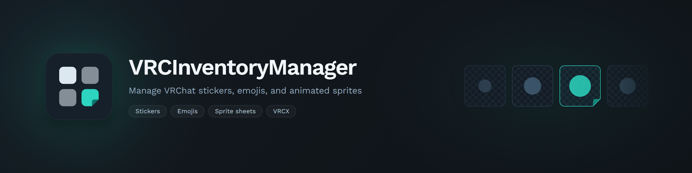

<p align="center"></p>

<p align="center">
  <a href="https://github.com/RealWhyKnot/VRCInventoryManager/actions/workflows/ci.yml"></a>
  <a href="https://github.com/RealWhyKnot/VRCInventoryManager/releases/latest"></a>
  <a href="https://github.com/RealWhyKnot/VRCInventoryManager/releases"></a>
  
  <a href="LICENSE"></a>
</p>

# VRCInventoryManager

Browse your VRChat screenshots and check how stickers and emoji will look before you upload them. You can also preview and delete uploads already on your VRChat account.

[Download](https://github.com/RealWhyKnot/VRCInventoryManager/releases/latest) · [Changelog](CHANGELOG.md) · [Report a bug](https://github.com/RealWhyKnot/VRCInventoryManager/issues/new) · [Security](.github/SECURITY.md)

## Install

On 64-bit Windows, run the setup file from the latest release. It installs for your Windows account and adds a Start menu shortcut. For a portable copy, unzip the win-x64 archive and run `VRCInventoryManager.exe`.

Sign into VRChat in [VRCX](https://github.com/vrcx-team/VRCX) to use the remote inventory. VRCInventoryManager reads the VRChat session cookies VRCX saved locally. If the session expires, sign in again in VRCX and select **Reconnect**. You can browse local files without VRCX.

## Browse and upload

- Use the folder tree and search to find local photos, stickers, emoji and prints. You can also drop image files or a folder onto the window.
- The **Photos** source reads `picture_output_folder` from `VRChat\VRChat\config.json` in your Windows LocalLow folder. It defaults to the `VRChat` subfolder of your Windows Pictures folder. See the [VRChat configuration guide](https://docs.vrchat.com/docs/configuration-file).
- The light table plays GIFs and PNG sprite sheets. Switch between checkerboard, dark and light backdrops to check transparency. Choose from 27 animation styles and override the upload's loop style.
- The app fetches your VRChat inventory page by page. Filter to stickers or emoji, preview an upload or delete it. The quota gauges show how many sticker and emoji slots you've used.

## Settings and updates

Open **Settings** to see the selected local folder, connection and app version, or turn off checks for updates. Stable builds offer stable releases. Beta builds can also offer prereleases.

The updater asks before it installs anything. It runs the new setup for an installed copy or replaces the executable for a portable copy, then reopens the app.

Settings live in `%APPDATA%\VRCInventoryManager\settings.json`. The app writes `VRCInventoryManager.debug.log` beside the executable, with a fallback to the settings folder. It keeps one backup and caps each file at 2 MiB. Set `VRCIM_DEBUG=1` before starting to include debug messages.

## Build from source

On 64-bit Windows, install rustup, the Visual Studio C++ build tools with a Windows SDK, Node.js 24, and PowerShell 7. Rustup uses the toolchain in `rust-toolchain.toml`. Cargo fetches the pinned Pageframe revision from GitHub.

Build the frontend before running Cargo. The Windows executable embeds the resulting HTML, CSS and JavaScript, and Pageframe renders the interface.

```powershell
npm ci
npm run build
cargo build --locked
cargo test --workspace --all-targets --locked
```

Install [NSIS](https://nsis.sourceforge.io) before building the portable zip and installer.

```powershell
.\build.ps1 -Release -RequireInstaller
```

The packages, SHA-256 files and integrity manifest go in `release\`. See [CONTRIBUTING.md](CONTRIBUTING.md) for the full local checks.

## License

GNU General Public License v3.0 or later. See [LICENSE](LICENSE).
